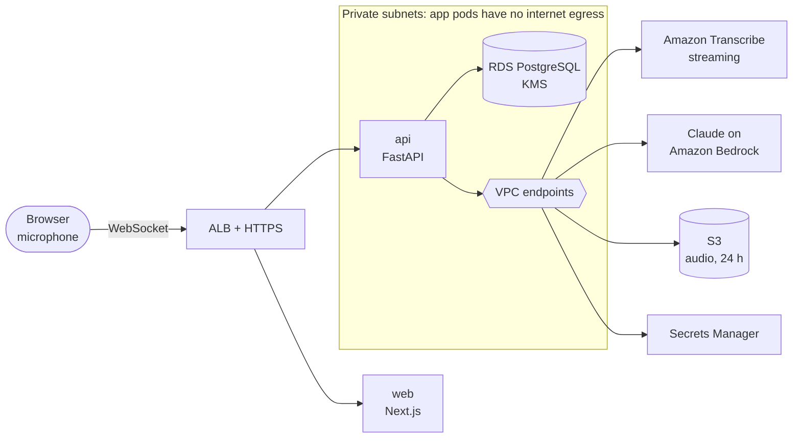

# Scope

Karute (カルテ, the Japanese word for a medical chart) listens to a doctor's visit and writes the chart. It is part 2
of AI on EKS and is about security: health data that never leaves your AWS network.

- **It is** an ambient clinical scribe: a live transcript during the visit, then a structured note, draft
  prescriptions and a patient summary that the clinician reviews and signs.
- **It is not** a medical device, and it makes no decisions of its own. It uses synthetic, role-played visits only;
  no real patient data. Healthcare compliance (HIPAA, Japan's APPI) is out of scope, though the controls follow the
  same ideas.

## Why healthcare

Writing notes takes a large share of a doctor's day, and AI scribes that draft the note from the conversation are
one of the most widely adopted uses of AI in hospitals. Health data is also the clearest case for strict security:
everyone understands why the transcript of a medical visit must not leak.

## The product

| Actor | Does |
|---|---|
| Clinician | Starts a visit, watches the live transcript, edits and signs the note |
| Patient (role-played) | Talks; receives the summary in their language |
| Auditor | Reads the audit log |

1. **Start a visit:** confirm the recording notice, then the browser streams microphone audio over a WebSocket.
2. **Live transcript:** Amazon Transcribe streaming returns text with speaker labels; it appears as people talk.
3. **Draft:** when the visit ends, Claude on Amazon Bedrock returns a SOAP note (Subjective, Objective, Assessment,
   Plan), a draft prescription list and a plain-language summary in the patient's language, as validated JSON.
4. **Review:** the clinician edits any part, then signs. Unsigned notes are marked DRAFT everywhere.
5. **Download:** a signed note downloads as PDF.

**API (v1):** `POST /v1/visits`, `WS /v1/visits/{id}/audio`, `POST /v1/visits/{id}/end`, `GET /v1/notes/{id}`,
`PATCH /v1/notes/{id}`, `POST /v1/notes/{id}/sign`, `GET /v1/audit?note=`. Demo clinician accounts sign in.

## Rules

| # | Rule | Enforced by |
|---|---|---|
| R1 | The AI drafts; the clinician decides. Nothing is final until signed. | Download needs `signed_by` and `signed_at`; unsigned notes carry a DRAFT mark |
| R2 | Synthetic data only. | Demo visit scripts in the repo; a banner on every screen |
| R3 | Visit data never crosses the public internet from the app. | App pods have no internet egress (NetworkPolicies); AWS services through VPC endpoints |
| R4 | Every read and edit of a note is recorded. | Append-only audit table, written in the same transaction as the change; reads logged too |
| R5 | Transcript and note text never appear in logs. | Logs carry IDs and timings only; a test fails if visit text reaches log output |
| R6 | Audio is deleted once the note is signed, or after 24 hours. | Retention job, with an S3 lifecycle rule as the backstop |
| R7 | Data is encrypted at rest with your own key. | KMS for RDS, S3 and Secrets Manager |

## Architecture (target)

## What it teaches on Kubernetes

New in part 2:

- Argo CD from the first deploy, with the app packaged as a Helm chart
- External Secrets Operator, syncing database credentials from AWS Secrets Manager
- NetworkPolicies, enforced by the Amazon VPC CNI: deny everything, then allow only what each pod needs
- Pod Security Standards (`restricted`) on the app namespace
- WebSockets through the ALB: idle timeouts, draining on deploy, a client that resumes the visit on any pod
- Why the database is RDS and not a StatefulSet (an ADR)

Reused from part 1: Terraform, ALB Ingress with ACM and ExternalDNS, HPA, Pod Identity.

## AI providers

| Task | Provider | Why |
|---|---|---|
| Speech to text | Amazon Transcribe streaming, with speaker labels | Stays in AWS, reached through a VPC endpoint |
| Note, prescriptions, summary | Claude on Amazon Bedrock | Called inside your AWS account through a VPC endpoint |

Tests use recorded responses, so CI never calls AWS.

## Results to publish

| Number | How it is measured |
|---|---|
| p95 speech-to-screen latency | Timestamps from the browser to the transcript event |
| Time to a full draft after the visit ends | p50 and p95 over the synthetic visit set |
| Transcript lost when the API is redeployed mid-visit | Drill; the target is none |
| RDS restore time | Timed restore from an automated backup |
| Cost per hour, and per visit | AWS Cost Explorer |

## Out of scope (v1)

Real patient data, EHR integration (FHIR, HL7), billing codes, e-prescribing, more than one clinic.
